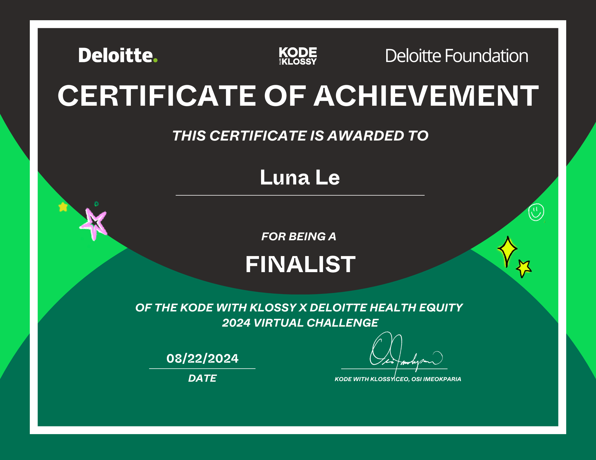

# Melanoma Equity

A web app built for the **Kode with Klossy x Deloitte 2024 Health Equity Competition**, where it was recognized as a finalist. It raises awareness about melanoma by providing information and tools for skin checks, plus a mole classification model that runs entirely in the browser.

**[Live demo](https://luna-505.github.io/MelanomaEquity)**


> ⚠️ **Disclaimer:** This is an educational project and not a medical tool. 

## Recognition
Finalist, Kode with Klossy x Deloitte 2024 Health Equity Competition.



## Features
- Educational information about melanoma and skin checks
- Steps by steps self-examinaton guide 
- Mole image classification (benign vs. malignant) using an in-browser ML mode

## Tech stack
- React and React Router
- TensorFlow.js / @teachablemachine/image
- Chakra UI

## Model details and limitations

The image classification model was trained with Google's Teachable Machine and exported to TensorFlow.js. The model files are served with the site and run client-side, so uploaded images never leave device.

- Classes: Benign Moles, Malignant Moles
- Input size: 224×224
- Training data: 647 images total (311 benign, 336 malignant)
- Skin tone coverage: training images cover Fitzpatrick skin types I–IV only.
  The model has not been trained or tested on skin types V–VI.
- Other limitations: small dataset, not clinically validated, and results
  may vary with lighting, image quality, and photo angle. Melanoma can also
  look different on darker skin (for example, on palms, soles, and nails),
  which a mole-focused model is unlikely to capture.

## Getting started

### Prerequisites
- Node.js (v18+)

### Run locally
```bash
git clone https://github.com/luna-505/MelanomaEquity.git
cd MelanomaEquity
npm install
npm start
```
The app opens at http://localhost:3000.

### Deploy
```bash
npm run deploy
```